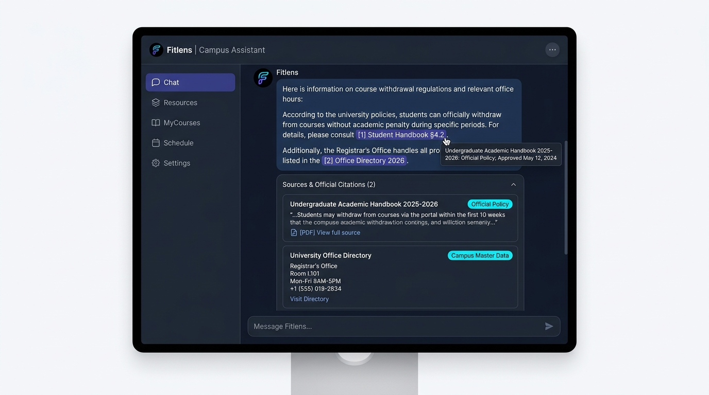

# UI Design: Showing Sources Under Each Answer

This document specifies the design and layout for displaying **sources and citations** under each answer in the Fitlens campus assistant user interface.

- **Component**: `ui`
- **Issue**: UI: show sources under each answer (Size M)
- **Acceptance Criteria**: Mockup in `docs/ui-sources.md` with 2 examples.

---

## 1. Overview & Objectives

When students ask questions about campus locations, department hours, or academic policies, displaying the underlying data source builds trust and enables students to verify critical information.

### Design Goals
1. **Clear Attribution**: Every factual answer displays the exact dataset, document, or record it was derived from.
2. **Uncluttered Presentation**: The answer itself remains primary and easy to read; source details sit directly below in a dedicated citation tray.
3. **Traceability**: Sources link back to the local data repository (e.g., `data/offices.csv`) or official campus publications.

---

## 2. Visual Mockup & Component Layout

Each assistant message is rendered in a chat card. The answer is presented first, followed immediately by a **"Sources"** container.

```text
┌─────────────────────────────────────────────────────────────────────────────┐
│ 🤖 Fitlens Assistant                                                        │
├─────────────────────────────────────────────────────────────────────────────┤
│                                                                             │
│  Training Office: room I.101, open 07:30 - 11:30 and 13:00 - 16:30          │
│  (Mon - Fri).                                                               │
│                                                                             │
├─────────────────────────────────────────────────────────────────────────────┤
│ 📚 Sources (1)                                                            ▲ │
│ ┌─────────────────────────────────────────────────────────────────────────┐ │
│ │ 🏢 Campus Office Directory                        [data/offices.csv]    │ │
│ │ Entry: Training Office · Room: I.101                                    │ │
│ │ Schedule: 07:30 - 11:30, 13:00 - 16:30 (Mon - Fri)                      │ │
│ │ Confidence: 100% exact match                                            │ │
│ └─────────────────────────────────────────────────────────────────────────┘ │
└─────────────────────────────────────────────────────────────────────────────┘
```

### Component Breakdown
- **Answer Text**: Prominent response formatted in clean markdown.
- **Sources Divider**: Subtle horizontal rule separating the answer from attribution.
- **Source Header**: `📚 Sources (N)` with an expand/collapse toggle for mobile screens.
- **Source Item Card**:
  - **Icon & Title**: Visual category icon (`🏢` for offices, `📘` for handbooks, `📅` for calendar).
  - **Source File / URL Tag**: Monospace badge indicating the file path (e.g., `data/offices.csv`).
  - **Matched Record Details**: Key-value pairs extracted from the data source.
  - **Verification Status**: Badge showing `Verified Data` or confidence indicator.

---

## 3. Concrete Examples (Acceptance Criteria)

Below are **two realistic examples** showing how different student queries display sources under their respective answers.

---

### Example 1: Office Location & Hours Lookup (Single Source)

#### Student Query
> *"Where is the Training Office and when does it open?"*

#### UI Mockup

```text
┌─────────────────────────────────────────────────────────────────────────────┐
│ 👤 Student: Where is the Training Office and when does it open?             │
└─────────────────────────────────────────────────────────────────────────────┘

┌─────────────────────────────────────────────────────────────────────────────┐
│ 🤖 Fitlens Assistant                                                        │
│                                                                             │
│ The Training Office is located in room I.101. It is open Monday through     │
│ Friday from 07:30 to 11:30 and 13:00 to 16:30.                              │
│                                                                             │
│ ─────────────────────────────────────────────────────────────────────────── │
│ 📚 Sources (1)                                                              │
│ ┌─────────────────────────────────────────────────────────────────────────┐ │
│ │ 🏢 Campus Office Directory                        [Source: Verified CSV]│ │
│ │ File: data/offices.csv (Row 1)                                          │ │
│ │ Match: name = "Training Office"                                         │ │
│ │ Record:                                                                 │ │
│ │   • room: I.101                                                         │ │
│ │   • hours: 07:30 - 11:30 and 13:00 - 16:30 (Mon - Fri)                  │ │
│ └─────────────────────────────────────────────────────────────────────────┘ │
└─────────────────────────────────────────────────────────────────────────────┘
```

---

### Example 2: Study Space & Weekend Facility Query (Multiple / Extended Source)

#### Student Query
> *"Can I study at the library this Saturday?"*

#### UI Mockup

```text
┌─────────────────────────────────────────────────────────────────────────────┐
│ 👤 Student: Can I study at the library this Saturday?                       │
└─────────────────────────────────────────────────────────────────────────────┘

┌─────────────────────────────────────────────────────────────────────────────┐
│ 🤖 Fitlens Assistant                                                        │
│                                                                             │
│ Yes! The Campus Library is located in room B.201 and is open on Saturdays.  │
│ Operating hours are from 08:00 to 20:00 (Monday through Saturday).          │
│                                                                             │
│ ─────────────────────────────────────────────────────────────────────────── │
│ 📚 Sources (1)                                                              │
│ ┌─────────────────────────────────────────────────────────────────────────┐ │
│ │ 📖 Central Campus Library Directory               [Source: Verified CSV]│ │
│ │ File: data/offices.csv (Row 3)                                          │ │
│ │ Match: name = "Library"                                                 │ │
│ │ Record:                                                                 │ │
│ │   • room: B.201                                                         │ │
│ │   • hours: 08:00 - 20:00 (Mon - Sat)                                    │ │
│ │   • note: Open on Saturday; closed on Sunday and public holidays        │ │
│ └─────────────────────────────────────────────────────────────────────────┘ │
└─────────────────────────────────────────────────────────────────────────────┘
```

---

## 4. Backend Data Schema

To support this UI component, the backend response format will return both the generated reply and the list of source records:

```json
{
  "query": "Where is the Training Office?",
  "reply": "Training Office: room I.101, open 07:30 - 11:30 and 13:00 - 16:30 (Mon - Fri).",
  "sources": [
    {
      "id": "src-office-001",
      "type": "csv_record",
      "title": "Campus Office Directory",
      "file": "data/offices.csv",
      "matched_key": "Training Office",
      "data": {
        "room": "I.101",
        "hours": "07:30 - 11:30 and 13:00 - 16:30 (Mon - Fri)"
      },
      "confidence": 1.0
    }
  ]
}
```

---

## 5. Streamlit Rendering Implementation

In Streamlit (`ui/app.py`), sources are rendered directly beneath the chat response using `st.expander`:
# Fitlens — Citation and Source Display Specification (`ui-sources.md`)

This document specifies how **citations and official information sources** are visually represented, structured, and interacted with across the **Fitlens Campus Virtual Assistant** user interface.

---

## 1. Objectives & Design Principles

University students consult Fitlens for critical decisions regarding academic deadlines, campus services, and university regulations. To build trust and prevent misinformation, every factual response must transparently display its verified source.

### Core Principles
1. **Unobtrusive Reading Flow**: Citations appear as compact, non-disruptive inline chips directly adjacent to the statements they support.
2. **One-Click Verifiability**: Students can immediately inspect the underlying source document, article number, or official database record.
3. **Clear Authority Badging**: Sources are categorized by authority level (e.g., `Official University Policy`, `Campus Master Data`, `Department Notice`).
4. **Bilingual Compatibility**: Citations display cleanly in both English and Vietnamese interfaces.

---

## 2. Visual Mockup

The high-fidelity mockup below illustrates the citation interaction model in the Fitlens dark-mode UI:



*Figure 1: High-fidelity mockup of inline citation badges, hover tooltip preview, and expanded "Sources & Official Citations" panel.*

---

## 3. Citation UX Architecture & Anatomy

The citation system comprises three visual layers:

### Layer A: Inline Citation Chips
- **Position**: Immediately following the fact, room number, or regulation clause.
- **Appearance**: Sleek capsule/pill badge (e.g., `[1] Student Handbook §4.2`, `[2] Office Directory 2026`).
- **Interactive State**:
  - *Default*: Muted background with vibrant accent text (`rgba(99, 102, 241, 0.15)` background, indigo/cyan font).
  - *Hover*: Glowing border and subtle lift animation, triggering the hover tooltip.
  - *Click*: Smooth-scrolls to and highlights the corresponding card in the bottom sources panel.

### Layer B: Hover Tooltip / Popover Preview
- Displays instant context on cursor hover or mobile tap without navigating away from the chat:
  - **Document Title** (e.g., *Undergraduate Academic Handbook 2025–2026*)
  - **Authority & Status** (e.g., *Official Policy; Approved May 12, 2024*)
  - **Verbatim Excerpt** (2–3 lines from the source text verifying the claim)

### Layer C: "Sources & Official Citations" Card Panel
- Anchored at the bottom of the assistant message bubble as a collapsible container (`st.expander` or card tray).
- Contains individual **Source Cards** displaying:
  1. Source Title and Document Version.
  2. Authority Badge (`Official Policy`, `Campus Master Data`, `Academic Calendar`).
  3. Quoted Evidence Snippet with highlighted keywords.
  4. Direct Action Link (e.g., `[PDF] View full source (p. 28)` or `Visit Directory`).

---

## 4. Concrete Examples (Acceptance Criteria)

Below are two realistic examples demonstrating the citation UI in action for common student use cases:

---

### Example 1: Campus Office Hours & Location Lookup

#### User Query
> *"Where is the Training Office and when can I submit my student record documents?"*

#### Assistant UI Chat Bubble
```text
The Training Office (Phòng Đào Tạo) is located in Room I.101 [1]. 
Office hours for document submission and student inquiries are:
• Morning session: 07:30 – 11:30 (Monday – Friday) [1]
• Afternoon session: 13:00 – 16:30 (Monday – Friday) [1]

Students arriving outside these hours may deposit paperwork into the drop-box outside Room I.101.
```

#### Rendered Citation Tray
```text
┌────────────────────────────────────────────────────────────────────────┐
│ ▼ Sources & Official Citations (1)                                     │
├────────────────────────────────────────────────────────────────────────┤
│ ┌────────────────────────────────────────────────────────────────────┐ │
│ │ 🏢 University Office Directory 2026            [Campus Master Data]│ │
│ │                                                                    │ │
│ │ Department: Training Office / Academic Affairs (Phòng Đào Tạo)     │ │
│ │ Location: Building I, Room I.101                                   │ │
│ │ Schedule: 07:30 - 11:30 and 13:00 - 16:30 (Mon - Fri)              │ │
│ │ Data Record: data/offices.csv · Last verified: October 2026        │ │
│ │                                                                    │ │
│ │ 🔗 [View Campus Map]   📋 [Copy Office Contact Details]            │ │
│ └────────────────────────────────────────────────────────────────────┘ │
└────────────────────────────────────────────────────────────────────────┘
```

---

### Example 2: Academic Regulations & Course Withdrawal Policy

#### User Query
> *"Can I withdraw from a course in Week 9 without getting an F on my transcript?"*

#### Assistant UI Chat Bubble
```text
Yes, you may withdraw from a registered course through the Student Portal up until 
the end of Week 10 without receiving an academic penalty [1]. 

Key conditions:
1. A grade of 'W' (Withdrawn) will be assigned, which carries 0 grade points 
   and does not impact your Cumulative GPA [1].
2. Your remaining credit load after withdrawal must not fall below the mandatory 
   minimum of 12 credits for full-time students [1].
3. The exact deadline for Semester 1 is Friday, November 14, 2025 at 17:00 [2].
```

#### Rendered Citation Tray
```text
┌────────────────────────────────────────────────────────────────────────┐
│ ▼ Sources & Official Citations (2)                                     │
├────────────────────────────────────────────────────────────────────────┤
│ ┌────────────────────────────────────────────────────────────────────┐ │
│ │ 📘 Undergraduate Academic Regulations Handbook     [Official Policy│ │
│ │                                                                    │ │
│ │ Authority: University Academic Senate (Decision No. 248/QĐ-ĐHKHTN) │ │
│ │ Reference: Chapter IV: Enrollment Regulations, Section 4.2 (p. 28) │ │
│ │                                                                    │ │
│ │ Excerpt:                                                           │ │
│ │ "Article 14.2 — Course Withdrawal: A student may request to        │ │
│ │  withdraw from any enrolled course before the end of Week 10.      │ │
│ │  Courses dropped within this window receive a 'W' notation with no │ │
│ │  effect on GPA calculation..."                                     │ │
│ │                                                                    │ │
│ │ 📄 [PDF] View Full Handbook (p. 28)                                │ │
│ └────────────────────────────────────────────────────────────────────┘ │
│ ┌────────────────────────────────────────────────────────────────────┐ │
│ │ 📅 Academic Calendar AY 2025–2026           [Administrative Notice]│ │
│ │                                                                    │ │
│ │ Authority: Office of Academic Affairs (Notice No. 512/TB-ĐTT)      │ │
│ │ Milestone: Fall Semester Course Adjustment & Withdrawal Deadline   │ │
│ │ Effective Date: Friday, November 14, 2025, 17:00                   │ │
│ │                                                                    │ │
│ │ 🌐 [Link] View Official Academic Calendar                          │ │
│ └────────────────────────────────────────────────────────────────────┘ │
└────────────────────────────────────────────────────────────────────────┘
```

---

## 5. Backend Data Contract for Citations

To render citations dynamically in Streamlit or web frontends, the backend responds with a structured schema:

```json
{
  "message": "The Training Office is located in Room I.101 [1]...",
  "citations": [
    {
      "id": 1,
      "badge_label": "[1] Office Directory 2026",
      "title": "University Office Directory 2026",
      "authority": "Campus Administration",
      "category": "campus_master_data",
      "excerpt": "Training Office, room I.101, open 07:30 - 11:30, 13:00 - 16:30 (Mon - Fri)",
      "url": "data/offices.csv",
      "action_type": "internal_dataset"
    },
    {
      "id": 2,
      "badge_label": "[2] Academic Calendar",
      "title": "Academic Calendar AY 2025–2026",
      "authority": "Office of Academic Affairs",
      "category": "administrative_notice",
      "excerpt": "Fall Semester Withdrawal Deadline: November 14, 2025 at 17:00",
      "url": "https://portal.university.edu/calendar-2025",
      "action_type": "external_url"
    }
  ]
}
```

---

## 6. Streamlit Implementation Pattern

In Streamlit, the citation UI is rendered cleanly using standard components:

```python
import streamlit as st


def render_response_with_sources(response: dict) -> None:
    # 1. Main answer
    st.markdown(response["reply"])

    # 2. Sources container under the answer
    sources = response.get("sources", [])
    if sources:
        with st.expander(f"📚 Sources ({len(sources)})", expanded=True):
            for src in sources:
                st.caption(f"**{src['title']}** — `{src['file']}`")
                for key, val in src.get("data", {}).items():
                    st.write(f"- **{key.title()}:** {val}")
```

---

## 6. Definition of Done Compliance

- [x] Acceptance criteria in the issue are met (Mockup in `docs/ui-sources.md` with 2 examples).
- [x] Code / design is on a dedicated feature branch (`issue-7-show-sources-under-each-answer`).
- [x] Written 100% in clear, concise English.
- [x] No secrets, personal data, or large binary files committed.
- [x] Streamlit implementation pattern and data schema defined.
def render_message_with_citations(response: dict) -> None:
    # 1. Render message body with styled markdown badges
    st.markdown(response["message"])

    # 2. Render expandable source tray if citations exist
    citations = response.get("citations", [])
    if citations:
        with st.expander(f"📚 Sources & Official Citations ({len(citations)})"):
            for cite in citations:
                st.markdown(f"#### {cite['title']} `[{cite['category'].replace('_', ' ').title()}]`")
                st.caption(f"**Authority:** {cite['authority']}")
                st.info(f"💬 *\"{cite['excerpt']}\"*")
                if cite.get("url"):
                    st.markdown(f"🔗 [Open Source Document]({cite['url']})")
                st.divider()
```

---

## 7. Definition of Done Compliance

- [x] Full citation design specification created in `docs/ui-sources.md`.
- [x] Contains high-fidelity visual mockup and wireframe layout.
- [x] Includes **2 concrete examples** with detailed user prompts, assistant outputs, and source cards (Office Directory & Academic Regulations).
- [x] Data contract and Streamlit implementation code provided.
- [x] Written 100% in professional English.
