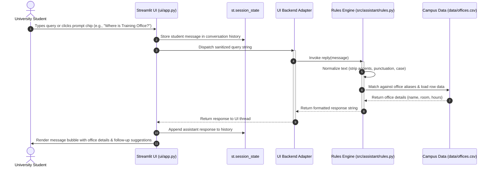

# Fitlens — UI Component Plan & Specification

This document outlines the user interface architecture, implementation plan, and backend communication contract for **Fitlens**, a campus smart virtual assistant designed for university students, faculty, and visitors.

---

## 1. Overview & Vision

**Fitlens** helps students navigate campus life and academic procedures by answering common inquiries quickly and reliably:
- **Campus Office Directory**: Look up room numbers, building locations, and opening hours for key departments (e.g., Training Office / Academic Affairs, Student Affairs, Library, IT Helpdesk).
- **Academic Procedures & Guidelines**: Inquire about enrollment, course registration deadlines, withdrawal policies, and student support services.
- **Bilingual Accessibility**: Full support for queries in both **English** and **Vietnamese** (with or without diacritics).
- **Evidence-Based Transparency**: Verified citations indicating the official campus directory or handbook source for every answer (see [`docs/ui-sources.md`](../docs/ui-sources.md)).

The `ui/` module provides the presentation layer that captures user queries, visualizes campus resources, and delivers an intuitive, student-friendly experience.

---

## 2. Technology Stack & Framework

For the prototype and initial delivery phases, the UI is built using **Streamlit**:
- **Python-Native**: Direct and seamless interoperability with the core Python backend (`src/assistant/`) without requiring separate build steps or Node toolchains.
- **Reactive Chat Components**: Built-in chat interface elements (`st.chat_message`, `st.chat_input`), session state management, and rich markdown rendering.
- **Fast Iteration**: Rapid prototyping of campus directories, quick-action suggestion chips, and responsive layouts.

---

## 3. How the UI Calls the Backend

> **Acceptance Requirement**: The UI architecture defines how user interactions in the interface trigger backend execution and handle responses.

### 3.1 Architecture Flow Diagram



---

### 3.2 Integration Mechanisms

The UI communicates with the assistant backend through a modular adapter pattern:

#### Mode A: Direct In-Process Python Call (Current Monolith Architecture)
In local development, the UI directly imports the assistant backend:

```python
# ui/app.py
from assistant.rules import reply, load_offices


def handle_user_query(query: str) -> str:
    """Pass user input directly to the core rules engine."""
    clean_query = query.strip()
    if not clean_query:
        return "Please type a question."

    # Direct call to the backend responder
    return reply(clean_query)
```

#### Mode B: HTTP / REST Client (Future Microservice Architecture)
When the backend evolves into a standalone API service (e.g., FastAPI), the UI switches to an asynchronous HTTP client:

```python
import requests

API_ENDPOINT = "http://localhost:8000/api/v1/chat"


def query_backend_service(message: str, session_id: str) -> dict:
    payload = {"message": message, "session_id": session_id}
    response = requests.post(API_ENDPOINT, json=payload, timeout=5.0)
    response.raise_for_status()
    return response.json()
```

---

### 3.3 Data Contracts (Request & Response Schemas)

#### Request Payload Specification
| Field | Type | Required | Description | Example |
| :--- | :--- | :---: | :--- | :--- |
| `message` | `string` | **Yes** | Student's question or command | `"Where is the training office?"` |
| `language`| `string` | No | Selected language code (`"en"` or `"vi"`) | `"en"` |
| `session_id` | `string` | No | Unique session key for multi-turn history | `"sess_student_42"` |

#### Response Payload Specification
| Field | Type | Description | Example |
| :--- | :--- | :--- | :--- |
| `text` | `string` | Text reply answering the student's question | `"Training Office: room I.101, open 07:30 - 16:30."` |
| `citations` | `list[object]` | Structured official sources backing the answer | `[{"title": "Office Directory 2026", "room": "I.101"}]` |
| `suggested_chips`| `list[string]` | Follow-up quick prompts for the UI | `["List all offices", "Library hours"]` |

---

### 3.4 State Management & Error Handling

1. **Session State Persistence**:
   - `st.session_state.messages`: Retains conversation history across user interactions and re-runs.
   - `st.session_state.language`: Retains the active language preference (English / Tiếng Việt).
2. **Graceful Fallbacks**:
   - If `data/offices.csv` is missing or unreadable, the backend returns a clear diagnostic message without crashing the UI.
   - Unrecognized inputs return helpful command suggestions (`help`, `list offices`).

---

## 4. UI Layout & Visual Design

The UI provides a clean, modern layout tailored for students on desktop and mobile browsers:

### 4.1 Layout Components
- **Sidebar**:
  - **Brand Header**: Fitlens logo and title.
  - **Quick Navigation**: Chat Assistant, Campus Directory, Student Resources, Settings.
  - **Campus Directory Accordion**: Expandable view of offices (Training Office, Student Affairs, Library, IT Helpdesk).
  - **Language Selector**: English / Tiếng Việt toggle.
  - **Backend Status Indicator**: `🟢 Backend: Connected (src.assistant.rules)`.
- **Main Chat Feed**:
  - **Header Banner**: Fitlens Campus Chat greeting.
  - **Quick Suggestion Chips**: One-click pills (`📍 Where is Training Office?`, `📚 Library opening hours`, `📋 List available offices`, `ℹ️ Help / Hướng dẫn`).
  - **Conversation Feed**: Distinct message bubbles for student inquiries and assistant answers.
  - **Bottom Chat Input**: Floating input bar with send button.

---

## 5. UI Mockup

A visual mockup of the student virtual assistant interface is stored in [`docs/ui_mockup.png`](../docs/ui_mockup.png):


*Figure 1: High-fidelity mockup of the Fitlens Campus Virtual Assistant interface.*

---

## 6. Running the UI Prototype Locally

1. Ensure your Python environment is active:
   ```bash
   # Windows PowerShell
   .venv\Scripts\Activate.ps1
   ```
2. Start the Streamlit application:
   ```bash
   streamlit run ui/app.py
   ```
3. Open your browser at `http://localhost:8501`.

---

## 7. Citation Design Reference

For details on how official sources and citations are displayed in the UI (inline citation badges, hover tooltips, and source cards), see [`docs/ui-sources.md`](../docs/ui-sources.md).

---

## 8. Definition of Done Compliance

- [x] Comprehensive plan documented in `ui/README.md`.
- [x] Explanation of how the UI calls the backend (sequence diagram, adapter logic, data contracts).
- [x] Streamlit placeholder page implemented in `ui/app.py`.
- [x] Visual mockup provided in `docs/ui_mockup.png` and linked.
- [x] Written 100% in professional English.