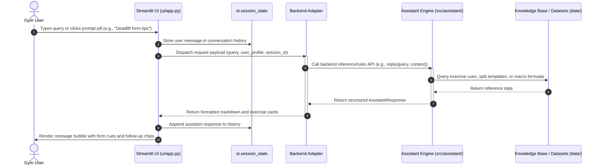
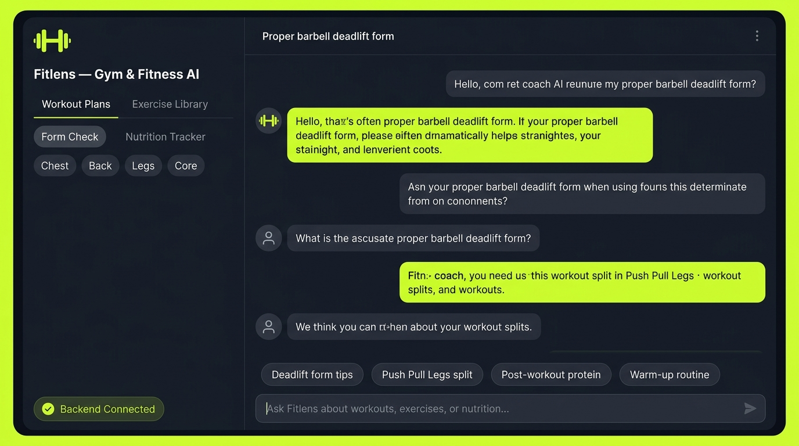

# Fitlens — UI Component Plan & Specification

This document outlines the user interface architecture, implementation plan, and backend communication contract for **Fitlens**, an intelligent virtual assistant tailored for **gym goers and fitness enthusiasts**.

---

## 1. Overview & Vision

**Fitlens** is designed to be a personal gym coach and fitness companion. Lifters and athletes can interact with Fitlens to:
- **Exercise Technique & Form Check**: Get cues and biomechanical checkpoints for compound movements (e.g., squats, deadlifts, bench press).
- **Workout Planning**: Generate and customize training splits (e.g., Push-Pull-Legs, Upper-Lower, Full Body) based on fitness goals and schedule.
- **Nutrition & Macro Guidance**: Calculate caloric and macronutrient targets (protein, carbs, fats) for cutting, bulking, or body recomposition.
- **Warmup & Mobility**: Receive targeted warm-up sequences and injury-prevention advice.

The `ui/` module provides the presentation layer that captures user queries, visualizes exercise data, and delivers an intuitive, lifter-friendly experience.

---

## 2. Technology Stack & Framework

For the prototype and initial delivery phases, the UI is built using **Streamlit**:
- **Python-Native**: Direct and seamless interoperability with the core Python backend (`src/assistant/`) without requiring complex build steps or node toolchains.
- **Reactive & Interactive**: Built-in chat widgets (`st.chat_message`, `st.chat_input`), session state management, and rich markdown/metrics rendering.
- **Fast Iteration**: Allows quick prototyping of fitness calculators, exercise visualizers, and conversational flows.

*Future phases may introduce a decoupled React / Next.js web client or mobile application connecting via REST/WebSocket APIs.*

---

## 3. How the UI Calls the Backend

> **Acceptance Requirement**: The UI architecture defines how user interactions in the interface trigger backend execution and handle responses.

### 3.1 Architecture Flow Diagram



---

### 3.2 Integration Mechanisms

The UI connects to the backend through a modular adapter pattern, supporting two progressive integration modes:

#### Mode A: Direct In-Process Python Call (Current Development & Monolith)
In local development, the UI directly imports the assistant interface from `src/assistant/`:

```python
# ui/adapter.py (conceptual interface)
from assistant.rules import reply  # or assistant.engine.get_advice


def call_assistant(message: str, user_profile: dict | None = None) -> str:
    """Pass user input to the backend engine and return the response."""
    # 1. Sanitize and trim input
    clean_message = message.strip()
    if not clean_message:
        return "Please enter a fitness question or select a topic above."

    # 2. Invoke the backend service
    response = reply(clean_message)
    return response
```

#### Mode B: HTTP / REST Client (Decoupled Microservice)
When the backend is deployed as an API service (e.g., FastAPI), the UI switches seamlessly to an HTTP client:

```python
import requests

BACKEND_API_URL = "http://localhost:8000/api/v1/chat"


def call_backend_api(
    query: str, session_id: str, profile: dict
) -> dict:
    payload = {
        "query": query,
        "session_id": session_id,
        "user_profile": profile,  # e.g., {"goal": "hypertrophy", "split": "PPL"}
    }
    response = requests.post(BACKEND_API_URL, json=payload, timeout=5.0)
    response.raise_for_status()
    return response.json()
```

---

### 3.3 Data Contracts (Request & Response Schemas)

#### Request Payload Specification
| Field | Type | Required | Description | Example |
| :--- | :--- | :---: | :--- | :--- |
| `query` | `string` | **Yes** | The user's typed question or prompt | `"Proper barbell deadlift form"` |
| `category` | `string` | No | Target module category | `"form_check"`, `"workout_plan"`, `"nutrition"` |
| `user_profile` | `object` | No | Lifter attributes and preferences | `{"experience": "intermediate", "goal": "strength"}` |
| `session_id` | `string` | No | Unique session key for multi-turn chat | `"sess_lifter_001"` |

#### Response Payload Specification
| Field | Type | Description | Example |
| :--- | :--- | :--- | :--- |
| `reply_text` | `string` | Markdown-formatted response from assistant | `"Keep a neutral spine and hinge at the hips..."` |
| `exercise_cues` | `list[string]` | Bulleted checklist for proper technique | `["Drive through heels", "Bar over midfoot"]` |
| `suggested_chips`| `list[string]` | Follow-up quick prompt pills for the UI | `["Push Pull Legs split", "Warm-up routine"]` |
| `status` | `string` | Execution status | `"success"` or `"error"` |

---

### 3.4 State Management & Error Handling

1. **Session State Persistence**:
   - `st.session_state.messages`: Preserves conversational turns between user reruns.
   - `st.session_state.lifter_profile`: Stores lifter preferences (experience level, target split).
2. **Graceful Fallbacks**:
   - If the backend is loading or unavailable, the UI renders an informative warning toast (`Backend in Standby / Mock Mode`) without crashing the application.
   - User inputs are validated to prevent empty messages or invalid payloads.

---

## 4. UI Layout & Visual Design

The UI design is optimized for high readability, modern dark aesthetics, and rapid access during workout sessions.

### 4.1 Layout Components
- **Sidebar**:
  - **Brand Header**: Fitlens dumbbell icon and tagline.
  - **Module Selector**: *Workout Plans*, *Exercise Library & Form Check*, *Nutrition Tracker*, *Progress Log*.
  - **Muscle Group Filters**: Quick pills for *Chest*, *Back*, *Legs*, *Core*.
  - **Backend Status Badge**: Visual indicator (`🟢 Backend Connected` or `🟡 Standby Mode`).
- **Main Chat & Content Area**:
  - **Topic Header**: Active subject or routine overview.
  - **Quick Prompt Pills**: One-click common queries (`Deadlift form tips`, `Push Pull Legs split`, `Post-workout protein`, `Warm-up routine`).
  - **Chat Message Feed**: Styled message bubbles distinguishing user inquiries and coach responses.
  - **Floating Input Box**: Convenient chat bar with quick submission.

---

## 5. UI Mockup

A visual mockup representing the target user interface is stored in [`docs/ui_mockup.png`](../docs/ui_mockup.png):



*Figure 1: High-fidelity mockup of the Fitlens Gym & Fitness AI Assistant Streamlit Interface.*

---

## 6. Placeholder Page (`ui/app.py`)

A runnable placeholder page is provided at [`ui/app.py`](app.py) to validate the component structure before complete backend feature wiring.

### Running the Placeholder Locally

1. Ensure the Python environment is active:
   ```bash
   # Windows PowerShell
   .venv\Scripts\Activate.ps1
   ```
2. Run the Streamlit application:
   ```bash
   streamlit run ui/app.py
   ```
3. Open your browser at `http://localhost:8501`.

The placeholder page renders the brand header, sidebar navigation, quick question chips, and an interactive input field that echoes responses in mock standby mode.

---

## 7. Implementation Roadmap

| Milestone | Scope | Deliverables | Status |
| :--- | :--- | :--- | :---: |
| **Phase 1: Setup & Plan (Size S)** | UI architecture, backend call plan, mockup, placeholder page | `ui/README.md`, `ui/app.py`, `docs/ui_mockup.png` | **Complete** |
| **Phase 2: Core Assistant Wiring** | Connect `ui/app.py` to fitness rules and CSV knowledge base | Interactive Q&A for workout splits & exercises | Planned |
| **Phase 3: Form Check & Calculators** | Add 1RM calculator, macro target estimator, form check checklists | Interactive Streamlit widgets and charts | Planned |
| **Phase 4: Multi-Modal Integration** | Integrate pose detection or video analysis for squat/deadlift form | Video uploader and visual feedback overlay | Future |

---

## 8. Definition of Done Compliance

- [x] Comprehensive plan created in `ui/README.md`.
- [x] Clear explanation of how the UI calls the backend (sequence diagram, calling mechanisms, request/response schemas).
- [x] Streamlit placeholder page implemented in `ui/app.py`.
- [x] High-fidelity UI mockup provided in `docs/ui_mockup.png`.
- [x] Entire document written in clear, professional English.